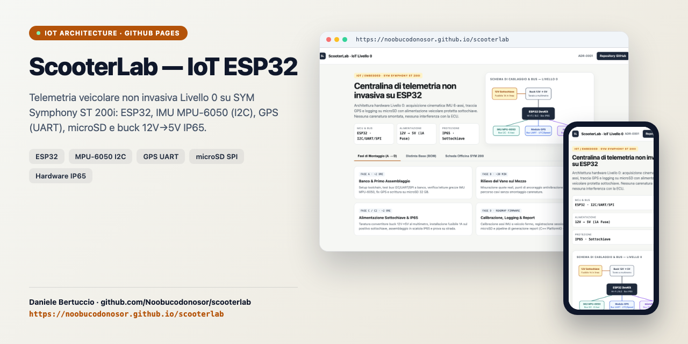

# ScooterLab — Telemetria IoT & Hardware Design (SYM Symphony ST 200i)

**Scheda Interattiva & Schema Cablaggio Live (GitHub Pages):** [https://noobucodonosor.github.io/scooterlab/](https://noobucodonosor.github.io/scooterlab/)

Progetto di **ingegneria IoT / embedded e telemetria veicolare non invasiva (Livello 0)** per **SYM Symphony ST 200i ABS (XB20E2-EU)**, progettato per registrare cinematica, dinamica e percorsi su strada senza alterare l'impianto o la ECU di serie.

> **Stato del progetto:** **Specifica Hardware Rev. 2, ADR-0001..0005, scaffold firmware ESP-IDF v6.x e pipeline dati Python (`.slab`, `analyze.py`, `ingest_server.py`, Docker stack) attivi** — Driver sensori su banco in completamento.

## Architettura Hardware Target (Rev. 2 — 2026)
- **Microcontrollore:** ESP32-S3 / ESP32-C5 (`ESP-IDF v6.x` / PlatformIO, TWAI/CAN integrato)
- **Inerziale (Smart IMU):** ST `ISM330IS` / Bosch `BHI360` su bus **SPI** (1–4 kHz + In-Sensor AI)
- **Posizionamento:** Modulo GNSS `u-blox M10` su **UART** (5–10 Hz, traccia, velocità reale, timestamp UTC)
- **Persistenza:** Modulo microSD High Endurance 32 GB su **SPI** (formato binario `.slab` v1 con CRC32)
- **Alimentazione & Sicurezza:** Positivo sottochiave 12 V → Fusibile 1 A → Buck 12 V → 5 V + partitore `IGN_SENSE` → Scatola stagna IP65; upload su Wi-Fi garage via **HTTPS TLS 1.3 + Bearer Token** (NVS cifrata)

## Documentazione Tecnica
- **[Indice ADR, Architettura Target 2026 & Master Task Backlog](./docs/adr/README.md)**
  - [ADR-0001 — Architettura Telemetria IoT ESP32 (Baseline Livello 0)](./docs/adr/0001-architettura-telemetria-iot-esp32.md)
  - [ADR-0002 — Aggiornamento Hardware, MCU & Smart IMU (Revisione 2026)](./docs/adr/0002-aggiornamento-hardware-sensori-2026.md)
  - [ADR-0003 — Sicurezza, Hardening (RED/CRA-Ready) e Privacy](./docs/adr/0003-sicurezza-hardening-red-cra-privacy.md)
  - [ADR-0004 — Pipeline Dati, Unified Namespace (UNS) e Automazione](./docs/adr/0004-pipeline-dati-telemetria-uns-automazione.md)
  - [ADR-0005 — Smart Garage Container Stack, TLS End-to-End & Hardening Ingest](./docs/adr/0005-smart-garage-container-stack-tls.md)
- [Istruzioni di Montaggio (Baseline Livello 0 — Legacy/Storico)](./docs/01-istruzioni-montaggio-livello-0.md)
- [Scheda Dati Tecnici Verificati da Officina](./docs/02-dati-tecnici-verificati.md)
- [Manuali e Fonti Ufficiali](./docs/03-manuali-e-fonti.md)
- [Specifica Formato Binario `.slab` v1](./docs/04-formato-slab.md)
- [Guida Officina, Verifica di Fabbrica & Smontaggio Scocche](./docs/05-guida-officina-manutenzione-smontaggio.md)
- [Roadmap & Progetto IoT Completo (Livelli 0 → 3, Stack 2026)](./docs/06-roadmap-architettura-iot-2026.md)
- [BOM Rev. 2 (2026) & Pinout ESP32-S3/C5](./docs/bom-rev2-2026.md)
- [AGENTS.md — Contesto & Regole per Sviluppatori e Agenti AI](./AGENTS.md)

## Stack & Competenze
- **Hardware & Embedded:** ESP32-S3/C5, `ESP-IDF v6.x`, Smart IMU `ISM330IS` (SPI), GNSS (UART), microSD (SPI), elettronica 12 V→5 V, protezioni IP65/fusibili
- **Backend & Sicurezza:** Python (`tools/analyze.py`, `tools/ingest_server.py`), Docker Compose, TLS 1.3, NVS cifrata, MQTT/UNS (`paho-mqtt`)
- **Metodologia:** Documentazione tracciabile per provenienza fonte (`[TUO]`, `[XB20]`, `[FAM]`, `[DERIV]`) + ADR-Driven
