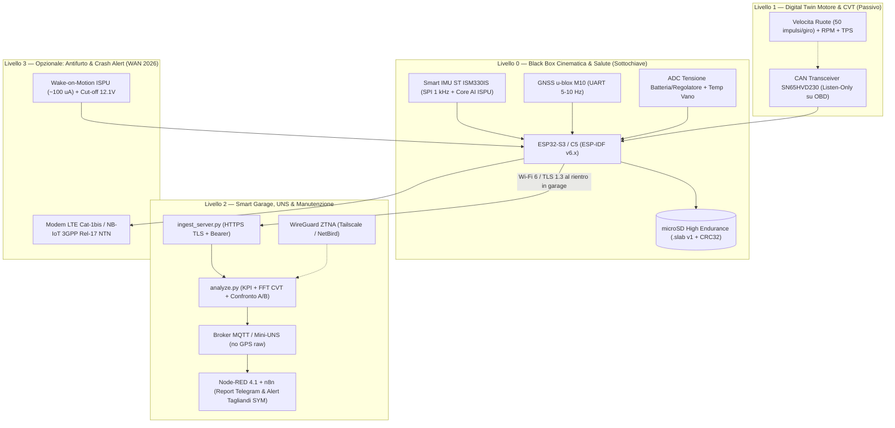

# ScooterLab — Roadmap & Progetto IoT Completo (Livelli 0 → 3, Stack 2026)

- **Veicolo Target:** SYM Symphony ST 200i ABS Euro 4 (2019 — `XB20E2-EU`, 169 cc 4T, batteria `12V 6Ah`, bus CAN OBD, anelli fonici ABS 50 fori)
- **Riferimenti:** [`ADR-0001`](./adr/0001-architettura-telemetria-iot-esp32.md) · [`ADR-0002`](./adr/0002-aggiornamento-hardware-sensori-2026.md) · [`ADR-0003`](./adr/0003-sicurezza-hardening-red-cra-privacy.md) · [`ADR-0004`](./adr/0004-pipeline-dati-telemetria-uns-automazione.md) · [`BOM Rev. 2`](./bom-rev2-2026.md)

---

## 1. Visione d'Insieme: Cosa Stiamo Progettando

L'obiettivo non è "mettere sensori a caso su uno scooter", ma costruire un **laboratorio di telemetria, diagnostica predittiva e manutenzione data-driven** progettato intorno ai **vincoli fisici reali** del Symphony ST 200i:
- **Vano sottosella caldo** (`[TUO]`): componenti grado industriale `-40/+85 °C`, piastra in PETG/ASA, zero SBC energivore (no Raspberry Pi a bordo).
- **Batteria compatta `12V 6Ah`** (`[TUO]`, dispersione massima `< 1 mA` `[XB20]`): Livelli 0–1 alimentati **strictly sottochiave**; eventuale Livello 3 antifurto solo con Deep Sleep `< 1–3 mA` e cut-off hardware a `12,1 V`.
- **Zero invasività su ECU, iniezione e ABS:** nessun filo originale tagliato; lettura CAN in modalità *listen-only* sul connettore OBD già presente nel vano anteriore.
- **Sicurezza 2026 (RED EN 18031 / CRA-ready):** nessuna password Wi-Fi in chiaro, NVS cifrata, upload HTTPS TLS + Bearer Token, Secure Boot v2 + Signed OTA, accesso remoto Zero Trust via WireGuard.

---

## 2. Architettura Incrementale in 4 Livelli

### Livello 0 — "Black Box" Cinematica, Vibrazioni & Salute Elettrica *(Partenza Immediata)*
*Nessuna carenatura esterna smontata — si installa solo aprendo il cestello sottosella (Livello A).*
- **Hardware:** `ESP32-S3` (o `ESP32-C5` Wi-Fi 6) + Smart IMU industriale **`ST ISM330IS`** su SPI (o `Bosch BHI360`) + GNSS **`u-blox M10`** (5–10 Hz) + `microSD High Endurance 32 GB` + Buck 12V→5V con fusibile `1 A` e circuito **Hold-Up (`IGN_SENSE`)** per chiusura pulita del file `.slab` allo spegnimento quadro.
- **2 sensori "quasi gratis" ad altissimo valore aggiunti nel Livello 0:**
  1. **Monitor tensione batteria / regolatore (partitore resistivo su ADC):** verifica ad ogni giro che la ricarica resti nella fascia di fabbrica **`14,0–14,8 V`** (`[XB20]`) e segnala cali batteria o regolatore guasto prima di restare a piedi.
  2. **Temperatura interna scatola/vano** (sensore integrato nella IMU `ISM330IS`): monitora lo stress termico reale nel vano sottosella del Symphony.
- **Cosa ottieni subito:**
  - **Baseline A/B scientifica prima e dopo il tagliando dei 30.000 km:** `0–50 km/h`, velocità reale, istogramma angoli di piega (senza deriva termica), indice di comfort sospensioni/asfalto.
  - **Analisi vibrazionale CVT (FFT / In-Sensor AI ISPU):** firma in frequenza del monocilindrico e della trasmissione per rilevare precocemente ovalizzazione rulli o slittamenti cinghia.

### Livello 1 — "Digital Twin" Motore, CVT & Ruote *(Zero Fili Tagliati)*
*Sfrutta il connettore diagnosi OBD già presente nel vano anteriore (`[XB20]`) e il controller TWAI/CAN integrato nell'ESP32-S3/C5.*
- **Hardware aggiunto (~5 €):** modulo transceiver CAN **`SN65HVD230`** (3,3 V) configurato in modalità **`TWAI_MODE_LISTEN_ONLY`** (impossibile interferire con ECU o ABS).
- **Cosa ottieni:**
  - **Curva reale di lavoro del CVT (`RPM vs Velocità`):** verifica sul campo se il variatore mantiene il motore nella banda ottimale **`7.600–8.100 rpm`** (`[TUO]`) e misura l'effetto reale di rulli/molle diverse.
  - **Velocità ruote ad altissima risoluzione:** gli anelli fonici Bosch da **50 fori** (`45120-XMC-000` / `43120-XJE-000`) offrono `3,43 cm/impulso`, permettendo di correlare accelerazioni, frenate e intervento ABS.
  - **Lettura passiva parametri ECU:** apertura farfalla (TPS), temperatura motore, codici errore EFI/ABS.

### Livello 2 — Smart Garage, Mini-UNS & Manutenzione Predittiva *(Home Lab 2026)*
*Gira su un PC/Mac o Raspberry Pi già in casa tramite Docker/Podman Compose (niente K3s).*
- **Flusso automatico al rientro in garage:**
  1. Arrivi a casa, lasci il quadro acceso 30 secondi (o accendi in garage): l'ESP32 aggancia il Wi-Fi domestico e invia i nuovi file `.slab` su **HTTPS TLS + Bearer Token** a [`tools/ingest_server.py`](../tools/ingest_server.py).
  2. [`tools/analyze.py`](../tools/analyze.py) genera il report HTML con confronto **A/B rispetto alla baseline** e aggiorna il chilometraggio cumulato.
  3. [`tools/maintenance_tracker.py`](../tools/maintenance_tracker.py) pubblica sul broker **MQTT / Mini-UNS** (`scooterlab/symphony200/telemetry/session_summary`) i soli **KPI aggregati** (mai coordinate GPS raw!).
  4. **n8n** (o Node-RED 4.1) riceve l'evento e ti manda su **Telegram** il riepilogo del giro + gli alert automatici prima delle scadenze ufficiali SYM (`3.000 km` olio motore, `6.000 km` olio trasmissione/filtro aria, `10.000 km` filtro benzina, `12.000 km` cinghia/rulli/candela).
  5. **Accesso remoto Zero Trust:** consulti i report da officina o smartphone via **Tailscale / NetBird** (WireGuard mesh), senza aprire alcuna porta sul router di casa.

### Livello 3 — Antifurto Smart, Crash Detection & WAN 2026 *(Opzionale / Avanzato)*
*Da valutare solo dopo che i Livelli 0–2 girano stabilmente.*
- **Wake-on-Motion tramite In-Sensor AI (`ST ISM330IS` ISPU):** a scooter spento l'ESP32 va in Deep Sleep (`~15–25 µA`) mentre il core ISPU della IMU resta attivo (`~50–100 µA`) per distinguere il vento/passaggio di un'auto dal sollevamento sul cavalletto o dal caricamento su furgone.
- **Protezione batteria obbligatoria:** comparatore/cut-off hardware a **`12,1 V`** per scollegare il modulo prima che la batteria `12V 6Ah` possa scaricarsi.
- **Connettività WAN futura (no 2G/3G):** modem **LTE Cat-1bis** o **NB-IoT 3GPP Rel-17 NTN** (es. Nordic `nRF9151` con fallback satellitare) con eSIM IoT per alert furto/caduta in tempo reale.

---

## 3. Piano Operativo in 4 Sprint (Da Oggi alla Strada)

| Sprint | Obiettivo | Budget Stimato | Deliverable / Issue GitHub |
| :--- | :--- | :--- | :--- |
| **Sprint 1 — Garage & Baseline Meccanica** | Check-up fabbrica (`docs/05`), foto vano/fusibili, misura circonferenza ruota reale, test multimetro sottochiave; tagliando **30.000 km** (mezzo a ~29.271 km). | Solo ricambi tagliando | Dati reali completati in [`docs/02-dati-tecnici-verificati.md`](./02-dati-tecnici-verificati.md) |
| **Sprint 2 — Banco & Livello 0 Rev. 2** | Acquisto BOM Rev. 2 (`ESP32-S3`, `ISM330IS`/`BHI360`, `u-blox M10`, microSD High Endurance, buck + hold-up, IP65); implementazione NVS cifrata (`#2`), client TLS (`#3`), hold-up `fsync()` (`#6`); montaggio e **3 giri di baseline**. | **~65–85 €** | Chiusura Issues `#2`, `#3`, `#6` + primo report HTML reale |
| **Sprint 3 — Smart Garage & Automazione** | Deploy `ingest_server.py` TLS + Mosquitto + n8n/Telegram + Tailscale/NetBird sul server/PC di casa. | **0 €** (hardware esistente) | Report automatico su Telegram + alert tagliandi SYM |
| **Sprint 4 — Livello 1 (CAN/OBD Listen-Only)** | Collegamento `SN65HVD230` al connettore OBD, cattura passiva frame CAN, decodifica RPM/TPS/ABS e grafico curva CVT `7.600–8.100 rpm`. | **~5–10 €** | Estensione `.slab` `REC_CAN` (tipo 3) + grafico CVT in `analyze.py` |
