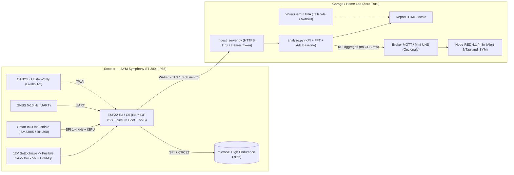

# Architecture Decision Records (ADR) & Master Task Backlog — ScooterLab

Questa cartella raccoglie gli **Architecture Decision Records (ADR)** e il **Master Task Backlog** del progetto **ScooterLab** (`Noobucodonosor/scooterlab`), documentando l'evoluzione dalla baseline Livello 0 (`ADR-0001`) allo stack IoT, Embedded, Sicurezza e Dati aggiornato al **novembre 2026**.

---

## Indice degli ADR

| ID | Titolo | Stato | Priorità | Autori / Fonti |
| :--- | :--- | :--- | :--- | :--- |
| **[ADR-0001](./0001-architettura-telemetria-iot-esp32.md)** | Architettura Hardware & Telemetria IoT Livello 0 (ESP32 + IMU + GPS) | Accettato (Baseline) | Core | Daniele Bertuccio |
| **[ADR-0002](./0002-aggiornamento-hardware-sensori-2026.md)** | Aggiornamento Hardware, MCU, Smart IMU e Sensoristica (Revisione 2026) | Accettato | **P1 — Alta** | Daniele Bertuccio / Audit 2026 |
| **[ADR-0003](./0003-sicurezza-hardening-red-cra-privacy.md)** | Sicurezza, Hardening (RED EN 18031 / CRA-Ready) e Privacy | Accettato | **P0 — Critica** | Daniele Bertuccio / Audit RED-CRA |
| **[ADR-0004](./0004-pipeline-dati-telemetria-uns-automazione.md)** | Pipeline Dati Telemetria, Unified Namespace (UNS) e Automazione Manutenzione | Accettato | **P1 — Alta** | Daniele Bertuccio / Audit 2026 |
| **[ADR-0005](./0005-smart-garage-container-stack-tls.md)** | Smart Garage Container Stack, TLS End-to-End & Hardening Ingest | Accettato | **P0 — Critica** | Daniele Bertuccio / Audit Multifocale |

---

## Diagramma Architetturale Target (2026)

---

## Master Task Backlog (Tutti i Task Censiti)

> **Nota:** Lo stato live (`Open` / `Closed`) di ciascun task può essere sincronizzato sulle **GitHub Issues** del repository. Usa `closes #<NumeroIssue>` nei commit per chiuderle automaticamente.

| Task ID | Issue | ADR | Titolo Task | File Coinvolti | Priorità | Stato | Assegnatari |
| :--- | :--- | :--- | :--- | :--- | :--- | :--- | :--- |
| **TASK-SEC-01** | `#1` | [ADR-0003](./0003-sicurezza-hardening-red-cra-privacy.md) | Configurazione `.gitignore`, `.env.example` e pre-release secret check | `.gitignore`, `.env.example`, `AGENTS.md` | **P0 — Critica** | In corso | `@Noobucodonosor` |
| **TASK-SEC-02** | `#2` | [ADR-0003](./0003-sicurezza-hardening-red-cra-privacy.md) | Provisioning sicuro Wi-Fi/Token con NVS cifrata nel firmware | `firmware/src/config_nvs.cpp`, `firmware/partitions.csv` | **P0 — Critica** | Parziale (host) | `@Noobucodonosor` |
| **TASK-SEC-03** | `#3` | [ADR-0003](./0003-sicurezza-hardening-red-cra-privacy.md) | Endpoint di ingestione HTTPS/TLS con autenticazione Bearer Token | `tools/ingest_server.py`, `firmware/src/uploader.cpp` | **P0 — Critica** | In corso | `@Noobucodonosor` |
| **TASK-HW-01** | `#4` | [ADR-0002](./0002-aggiornamento-hardware-sensori-2026.md) | Aggiornamento BOM Rev. 2 e pinout SPI/UART/TWAI | `docs/bom-rev2-2026.md` | **P1 — Alta** | In corso | `@Noobucodonosor` |
| **TASK-HW-02** | `#5` | [ADR-0002](./0002-aggiornamento-hardware-sensori-2026.md) | Scaffold progetto firmware ESP-IDF v6.x / PlatformIO | `firmware/platformio.ini`, `firmware/src/main.cpp` | **P1 — Alta** | In corso | `@Noobucodonosor` |
| **TASK-HW-03** | `#6` | [ADR-0002](./0002-aggiornamento-hardware-sensori-2026.md) | Protezione chiusura file microSD su spegnimento quadro | `firmware/src/power_monitor.cpp` | **P1 — Alta** | Parziale (host) | `@Noobucodonosor` |
| **TASK-DATA-01** | `#7` | [ADR-0004](./0004-pipeline-dati-telemetria-uns-automazione.md) | Specifica formato binario `.slab` v1 e generatore sintetico | `docs/04-formato-slab.md`, `tools/pyproject.toml`, `tools/make_test_session.py` | **P1 — Alta** | In corso | `@Noobucodonosor` |
| **TASK-DATA-02** | `#8` | [ADR-0004](./0004-pipeline-dati-telemetria-uns-automazione.md) | Parser telemetria `analyze.py` con report HTML e confronto A/B | `tools/analyze.py`, `tools/templates/report.html` | **P1 — Alta** | Parziale | `@Noobucodonosor` |
| **TASK-DATA-03** | `#9` | [ADR-0004](./0004-pipeline-dati-telemetria-uns-automazione.md) | Integrazione opzionale MQTT/UNS & scadenziario manutenzione SYM | `tools/maintenance_tracker.py`, `tools/mqtt_publisher.py` | **P2 — Media** | In corso | `@Noobucodonosor` |
| **TASK-HW-04** | `#10` | [ADR-0002](./0002-aggiornamento-hardware-sensori-2026.md) | Scaffold ESP-IDF compilabile (`CMakeLists.txt`) & fix `main.cpp` / `uploader.cpp` | `firmware/CMakeLists.txt`, `firmware/src/CMakeLists.txt`, `firmware/src/main.cpp`, `firmware/src/uploader.cpp` | **P0 — Critica** | In review | `@Noobucodonosor` |
| **TASK-INFRA-01** | `#11` | [ADR-0005](./0005-smart-garage-container-stack-tls.md) | Smart Garage Container Stack, TLS End-to-End & Hardening `ingest_server.py` | `docker/*`, `tools/ingest_server.py`, `tools/mqtt_publisher.py` | **P0 — Critica** | In review | `@Noobucodonosor` |
| **TASK-DOC-01** | `#12` | [ADR-0005](./0005-smart-garage-container-stack-tls.md) | Riallineamento `docs/adr/README.md`, `README.md` e guida montaggio | `docs/adr/README.md`, `README.md`, `docs/01-istruzioni-montaggio-livello-0.md` | **P0 — Critica** | In review | `@Noobucodonosor` |
| **TASK-HW-05** | `#13` | [ADR-0002](./0002-aggiornamento-hardware-sensori-2026.md) | Dual-SPI (`SPI2`/`SPI3`), Ring-Buffer SD 4 KB, Hold-Up & TVS 12 V (nuovo ADR-0006) | `docs/bom-rev2-2026.md`, `firmware/src/slab_writer.cpp` | **P1 — Alta** | Open | `@Noobucodonosor` |
| **TASK-DATA-04** | `#14` | [ADR-0004](./0004-pipeline-dati-telemetria-uns-automazione.md) | Fix `analyze.py` (GPS fix/HDOP, FFT/Welch reale) & recovery `.slab` | `tools/analyze.py`, `tools/slab_codec.py` | **P1 — Alta** | Open | `@Noobucodonosor` |
| **TASK-QA-01** | `#15` | — | Pipeline GitHub Actions CI (`pre_release_check`, `pytest`, host C++17) | `.github/workflows/ci.yml` | **P1 — Alta** | Open | `@Noobucodonosor` |
| **TASK-DATA-05** | `#16` | [ADR-0004](./0004-pipeline-dati-telemetria-uns-automazione.md) | Estensione `.slab` v1.1/v2 (`REC_CAN`/`REC_HEALTH`) + `report.html` (nuovo ADR-0007) | `docs/04-formato-slab.md`, `tools/templates/report.html` | **P2 — Media** | Open | `@Noobucodonosor` |
